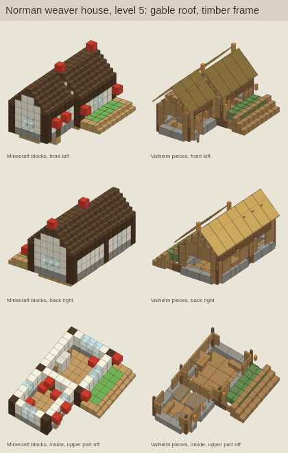
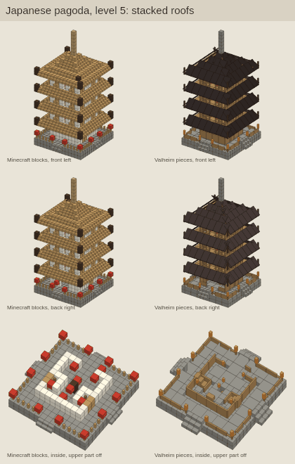
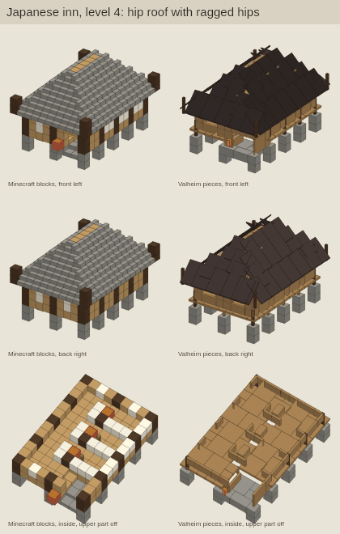
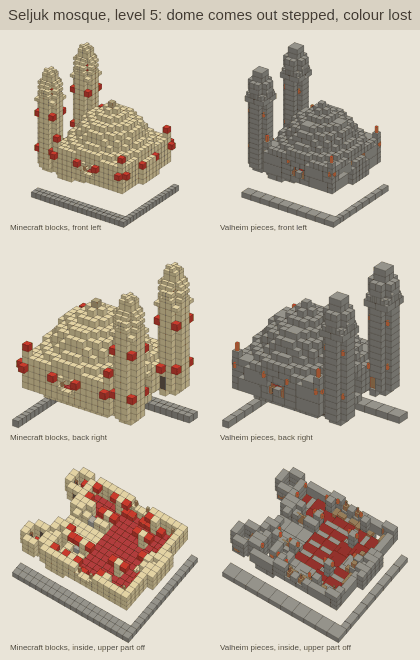
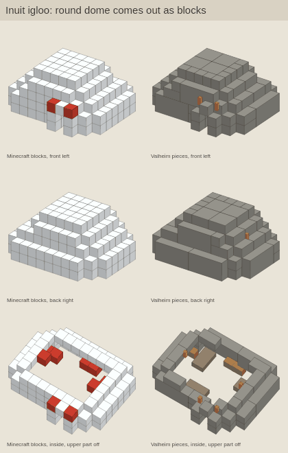
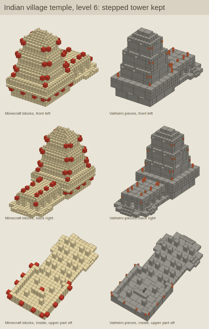
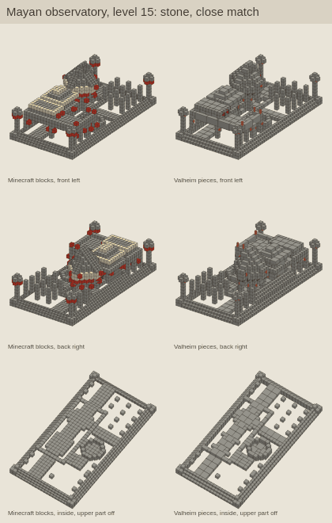
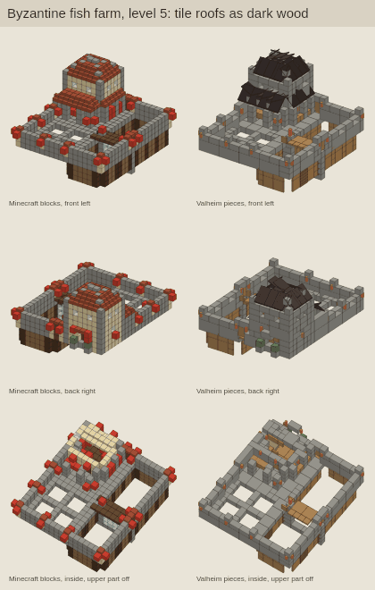

# Millénaire to Valheim translation pilot

A converter that turns Millénaire building schematics (Minecraft structure files) into PlanBuild blueprints, so the
blueprint lab can learn plans, roofs and room uses for cultures its corpus barely has (3 Middle Eastern and 36 East
Asian builds in 2,134). Built and measured 2026-11-08 on branch `night2/mc`. Nothing here changes the lab's data, and
nothing converted is used by villages.

Millénaire is All Rights Reserved. The schematics and every converted design stay outside the repo
(`/home/claude/corpus/mc/`, `/tmp`), are never shipped and never go into a folder Villheim reads. The repo holds the
converter, the block map, tests, this doc and eight small pictures of our own translations.

## Verdict

Tenable for **plans, footprints, storey layout, flat and gable roofs, and room uses** in five of seven cultures. Not
tenable as a source of **materials, hip and round roofs, or furniture detail**. Every block name is mapped, and the
shapes come out at the right size, but most of the look of these cultures sits in colours Valheim's vanilla pieces do
not have.

| Culture | Use it for | Leave out | Why |
|---|---|---|---|
| Mayan | plans, flat roofs, stepped pyramids, room uses | nothing big | stone stays stone (9 % of blocks change material), 89 % of buildings fully supported, 95 % of footprints within 1 m |
| Indian | plans, flat roofs, stepped temples, room uses | colours | 94 % pass every check; 85 % of blocks are sandstone or mud brick drawn as grey stone |
| Japanese | plans, gable roofs, tiered pagodas, raised floors | hip roof details, thin posts | footprint 95 % and height 100 % within 1 m; hips come out ragged; 43 % fully supported (posts and roof ornaments touch only at corners) |
| Norman | plans, gables, room uses | anything feeding Norse or biome palettes | 83 % fully supported, 74 % doors clear; overlaps the existing medieval set |
| Seljuk | plans, courtyards, flat roofs, room uses | domes, colours | domes come out as stepped blocks; 72 % of blocks change material; 60 % fully supported |
| Byzantine | plans and room uses only | roofs, outer walls, doors | only 51 % of footprints within 1 m (thin outer walls), 49 % of doors clear, tile roofs as dark wood |
| Inuit | room uses only | shapes | igloos and sod tunnels become boxes; ice floors vanish; 70 % fully supported |

## What was built

| File | What it does |
|---|---|
| `tools/blueprint-lab/lab/mc_convert.py` | Composes a building level from Millénaire's level files, maps blocks, fits Valheim pieces, writes `.blueprint`, a `.voxels.json` of the original blocks and a `.stats.json` (what happened to every block, rooms, sizes, terrain). Optional `--squash 1` (see Scale). |
| `tools/blueprint-lab/data/mc-blockmap.json` | Block names to kinds, materials and prefabs; families of Valheim pieces; per-culture material and roof choices; crops, trees, carpets; picture colours. A new file; the four existing data files are unchanged (hashes below). |
| `tools/blueprint-lab/lab/test_mc_convert.py` | Tests on hand-made block grids: roof direction and height, door, wall cover, floor cover, stone volume, slab roofs, beds, rooms. All pass. |
| `tools/blueprint-lab/lab/mc_render.js` | Side-by-side picture: the original blocks as coloured cubes next to our pieces, three views, through `lib/render.js`. |
| `tools/blueprint-lab/lab/mc_eval.js` | Runs `lib/checks.js` on every translation and compares footprint and height with the original. Adds a terrain-aware support count (see Measurements). |
| `tools/blueprint-lab/lab/mc_compare.py` | Builds an mc-only corpus and runs `build_corpus.py`, `learn.py` and `shapes.py` on it, all cultures and each alone, into `/home/claude/corpus/learn-mc/`. |
| `tools/blueprint-lab/lab/mc_pieces_fix.js` | Piece size fixes used only by these scripts (below). `lib/pieces.js` is untouched. |

## How a schematic becomes a blueprint

1. **Levels.** Each level file holds only what changes; air removes. Level L is levels 0 to L laid in order.
   Sub-buildings (an inn room, a tower top) are changes over a parent and are measured apart.
2. **Ground.** Dirt, grass, sand, gravel, paths, water, Millénaire's ground markers and "free" fill are terrain: they
   are dropped and their top per column is kept for the support count. `ground_level` from the plan sets y = 0.
3. **Coordinates.** Minecraft (x, y, z) becomes Valheim (x, y, -z), so a build is not mirrored. Yaw a turns local +z to
   (sin a, cos a), as in `learn.py`.
4. **Roofs.** Stairs are grouped by facing and by their 45 degree plane; a group high up with open sky over it is a
   roof. Two stairs along the ridge by two rows up the slope make one 45 degree piece, rising toward the stairs'
   facing. The piece's top face runs through the stairs' step noses, half a block above the line through their low
   corners. Slabs that step up half a block per block make 26 degree pieces. A block row with roof rising to it from
   both sides becomes ridge caps. One or two stairs alone on a roof are trim and are left out.
5. **Floors.** A solid block with nothing over it, in a 2 x 2 of such blocks, is floor: 2 x 2 and 1 x 1 floor pieces
   at the block's top. The floor runs under the wall's foot. Where a thin floor would hang 0.75 m over the wall below
   (a 1 m block becomes a 0.25 m floor at its top), the floor block over the wall also becomes a wall row.
6. **Walls.** Stone and other thick families cover the blocks exactly: 4 x 2, 2 x 1 and 1 x 1 stone pieces, 1 m thick,
   largest first. Wood and other thin families sit on the centre line of the block row, between block centres, so
   corners close with no gap or fin. A door or window block opens both centre-line spans beside it: a one-block door
   becomes a 2 m Valheim door, a one-block window a 2 x 1 gap.
7. **Posts and fences.** Vertical logs at corners become poles (4, 2 or 1 m); fences become rails between posts.
8. **Furniture.** Beds, chests, crafting tables, furnaces, cauldrons, anvils, fire pits, torches, banners and
   Millénaire's decor blocks map to Valheim furniture (table below). Facing follows the block, plus the corpus's own
   turn for that piece (`rel` in `rules.json`). A single stair on a floor indoors with no stair beside it is a chair.
   Carpets become one rug per 2 x 2. Crops on Millénaire's soil markers become the lab's crop pickables.
9. **Rooms.** Walkable cells on one level are joined; walls and doors split them. A room's use comes from what is in
   it and from Millénaire's markers (sleeping, selling, crafting, healing): bedroom, kitchen, shop, workshop, shrine,
   storage, hall, guard.

## Scale

**One block is one metre on every axis.** Evidence:

- A player is about 1.8 m tall in both games, and a block is 1 m.
- Roof pitch is exact at 1:1. A stair roof rises one block per block (45 degrees); Valheim's 45 degree pieces rise 2 m
  over 2 m. A slab roof rises half a block per block (26.6 degrees); Valheim's 26 degree pieces rise 1 m over 2 m.
- A Minecraft door is two blocks high; a Valheim door is 2 m high. Its slot is 2 m wide (corpus: a `wood_door` sits
  2 m from the centre of the `woodwall` beside it and 1 m from a pole).
- Footprints land within 1 m of the original in 82 to 97 % of buildings in six of the seven cultures (table below).

The cost is storey height. Floor-to-floor heights over 1 m, measured the same way on both sides:

| Gap (m) | Valheim corpus (1,427 designs) | Translations at 1:1 (302 buildings) |
|---|---|---|
| 2 | 289 | 59 |
| 3 | 152 | 46 |
| 4 | 128 | 77 |
| 5 | 55 | 55 |

Valheim builds mostly stack 2 m and 3 m storeys; the translations peak at 4 m (a 1 m floor block plus three rows). The
optional squash (`--squash 1`) takes out plain wall rows until each storey has two rows over its floor. A row may go
only if, across the whole building, it holds nothing but solid blocks and air; that was true in 396 of 1,806
translations (22 %). It moved some 5 m storeys to 3 m but left the 4 m peak, and it dropped Japanese full support from
43 % to 29 %. The default stays 1:1; storey heights from Millénaire should be read as taller than Valheim's.

## Block map

All 257 block names in the 1,811 schematics are mapped; none is unmapped. What does not carry over:

| Minecraft or Millénaire | Valheim | Loss |
|---|---|---|
| sandstone, mud brick, quartz, painted and decorated brick, ochre and red sandstone, Byzantine mosaic and fresco | stone family (`stone_wall_*`, `stone_floor_2x2`) | cream, white, red and blue walls all turn grey; 85 % of Indian blocks, 72 % Seljuk, 44 % Byzantine |
| Byzantine roof tiles | dark wood roof | red tile roofs turn dark |
| timber frame plaster | plank walls | white panels between dark beams are lost |
| snow and ice brick | stone family | igloos turn grey |
| wool, sod, hide | plank walls | tents and sod houses turn to wood |
| paper walls | plank wall, with the second row of a paper run left open as a window gap | shoji screens read as half walls |
| glass, panes, bars, ice | window gaps | no glass (glass is a Mountain material); ice ponds vanish |
| bookshelf | chest | no vanilla bookshelf |
| statues, icons, hangings | `blackmarble_head01`, `itemstand`, banners | stand-ins |
| furnace marker | `piece_oven` | Valheim cooks over fire; the oven marks a kitchen |
| trapdoors, buttons, pressure plates, redstone, cake | left out | minor |
| leaves, grass | left out as nature | trees are placed from Millénaire's tree markers instead |

Material choice per culture uses vanilla pieces only: wood (`woodwall`, `wood_wall_half`, `wood_wall_quarter`), log
(`wood_wall_log`, `wood_wall_log_4x0.5`, `wood_pole_log`), dark frame for Japanese timber (`darkwood_pole`), stone
(`stone_wall_4x2`, `_2x1`, `_1x1`, `stone_floor_2x2`, `stone_stair`). Roofs: thatch (`wood_roof`, `_45`,
`wood_roof_top_45`) by default, dark wood for Japanese and Byzantine and for tile blocks. For Seljuk, Indian and Mayan
builds, stone and sandstone stairs high up are stepped cornices and temple tiers, so they stay stepped stone. A
grausten family is in the map for a later Ashlands choice and is not used now.

### Piece sizes measured from the corpus

`lib/pieces.js` guesses sizes from names. Offsets between neighbouring pieces in `corpus.json` show four are off; the
study scripts patch them in their own process only (`lab/mc_pieces_fix.js`):

- `wood_wall_quarter` is 1 x 1 m (quarters stack 1 m up and 1 m along, 1.5 m from a 2 x 2 wall's centre); the name
  rule says 2 x 0.5.
- `stone_wall_1x1` is a 1 m cube and `stone_wall_4x2` is 1 m thick (neighbours 1 m apart in depth).
- `wood_wall_log_4x0.5` is a 4 m log 0.5 m high; the name rule makes it a 0.25 m beam.
- `piece_walltorch` matches the wall rule, so the lab draws and checks every wall torch as a 2 x 2 wall. This affects
  the lab's own pictures and checks for the 271 designs with wall torches in the first corpus (1,427 designs). Worth fixing in `lib/pieces.js`.

## Measurements

All 1,806 compositions (every level of every variant; 5 Inuit plans have no blocks) were converted. Numbers below are
over whole buildings; sub-buildings are counted in brackets and left out. "Blocks given a piece" counts every
building block (not terrain or markers) that ended up under some Valheim piece or inside a solid mass; it says nothing
about material. "Floating" uses `lib/checks.js`'s support walk with one change: a piece also stands when its foot is
on the Minecraft terrain under it (the converter drops terrain; in game the ground holds those pieces). The lab check
as it is (ground at the lowest piece) is in brackets.

| Culture | Buildings | Blocks given a piece (median, 10th pct) | Blocks lost | Pieces floating | Fully supported | Doors clear | Floor space | Footprint within 1 m | Height within 1 m |
|---|---|---|---|---|---|---|---|---|---|
| Byzantine | 233 (+66) | 99.9 %, 96.8 % | 1.66 % | 0.5 % | 64 % (37 %) | 49 % | 100 % | 51 % | 99 % |
| Indian | 218 (+11) | 100 %, 99.7 % | 0.08 % | 0.1 % | 99 % (78 %) | 94 % | 100 % | 97 % | 76 % |
| Inuit | 129 (+3) | 100 %, 97.9 % | 0.67 % | 4.0 % | 70 % (50 %) | 97 % | 100 % | 82 % | 95 % |
| Japanese | 199 (+2) | 100 %, 99.4 % | 0.20 % | 1.0 % | 43 % (29 %) | 94 % | 100 % | 95 % | 100 % |
| Mayan | 219 (+17) | 100 %, 100 % | 0.00 % | 0.1 % | 89 % (78 %) | 94 % | 99 % | 95 % | 97 % |
| Norman | 311 (+138) | 100 %, 98.5 % | 0.25 % | 0.5 % | 83 % (64 %) | 74 % | 99 % | 84 % | 97 % |
| Seljuk | 221 (+39) | 100 %, 99.4 % | 0.44 % | 1.5 % | 60 % (40 %) | 82 % | 100 % | 82 % | 99 % |

Overlap passes in 99.5 to 100 % of buildings. Median pieces per building: 92 (Inuit) to 335 (Byzantine), about 44 to
63 pieces per 100 blocks.

What the failures are:

- **Floating pieces** are mostly 1 m poles and roof ornaments that touch the rest only at a corner (Minecraft has no
  support rule), roof rows of ragged hips, and floor tiles at the edges of decks. Most failing buildings have one to
  five floating pieces.
- **Doors** fail on entrance steps right in front of the door (stone and wood stairs) and on torches in the door
  reveal. Byzantine churches and forts have many of both.
- **Byzantine footprints** come out 1 to 2 m narrow: their outer walls and fences are thin families, and a thin wall
  sits on the centre line of its block row, half a block in from the outside on each side.
- **Indian heights** are 1.5 m over in a quarter of buildings. Their thatch roofs are one or two stair rows deep; a
  single row still gets a full 2 m roof piece, which reaches a row higher than the stairs, and every roof piece's top
  face sits half a block over the stair blocks.
- **Lost blocks** are planks between two openings (both centre-line spans open; this is the main cost of thin walls on
  centre lines) and stair trim on roofs.

### Pictures

Left: Minecraft blocks as cubes (red cubes are furniture, torches and banners). Right: our Valheim pieces. Same
angles: front left, back right, inside with the upper part off.

- `mc-translation/norman-weaverhouse.png`: gable roof, timber walls and floor plan match. The white plaster and dark
  frame become plain wood.
- `mc-translation/japanese-pagoda.png`: five roof tiers and the spire come through closely.
- `mc-translation/japanese-inn.png`: a hip roof. The planes are right; the hips are ragged where square 2 x 2 pieces
  overlap. Valheim's hip corner pieces would close them; not done.
- `mc-translation/seljuk-mosque.png`: minarets and the courtyard plan hold. The dome is stepped blocks and every wall
  turns grey.
- `mc-translation/inuit-igloo.png`: the dome becomes a box of large stone pieces. Round shapes do not translate.
- `mc-translation/indian-temple.png`: the stepped tower holds as stepped stone; the colour does not.
- `mc-translation/mayan-observatory.png`: stone platform, columns and the tower match closely.
- `mc-translation/byzantine-fishfarm.png`: walls and plan match; red tile roofs come out dark and rough.










## What an mc corpus would add

The top level of each whole building, 477 designs after the corpus reader skipped 12 copies, learned alone into
`/home/claude/corpus/learn-mc/` (all cultures in `all/`, each culture in its own folder; `compare.json` holds the
numbers).

| Culture | Would feed | Designs | Plans (top 3) | Roofs (top 3) | Walls (top 2) | Indoor rooms by use | Blocks that change material |
|---|---|---|---|---|---|---|---|
| Byzantine | new: byzantine | 62 | L 14, none 13, irregular 12 | cross-gable 22, none 20, gable 9 | stone 51, plank 3 | bedroom 55, storage 23, workshop 10, shop 5, kitchen 5 | 51 % |
| Indian | new: south-asian | 64 | L 15, irregular 14, none 14 | none 22, flat 18, gable 5 | stone 51, plank 2 | bedroom 31, kitchen 11, shop 7, storage 3, workshop 2 | 85 % |
| Inuit | new: arctic | 60 | none 17, irregular 15, rectangle 9 | none 21, flat 13, cross-gable 8 | plank 26, stone 14 | bedroom 29, kitchen 7, storage 3, shrine 2, shop 1 | 23 % |
| Japanese | east-asian (36 today) | 56 | irregular 20, T 7, L 6 | cross-gable 32, flat 8, none 7 | plank 29, stone-base 15 | bedroom 28, storage 19, workshop 13, kitchen 7, shop 5 | 18 % |
| Mayan | new: mesoamerican | 64 | irregular 19, rectangle 14, none 6 | flat 44, none 13, gable 2 | stone 58, plank 4 | bedroom 45, kitchen 13, storage 13, shrine 3, shop 2 | 9 % |
| Norman | castle-medieval (170 today) | 92 | irregular 17, L 16, none 14 | gable 29, cross-gable 25, none 20 | stone 42, plank 20 | bedroom 72, storage 32, kitchen 15, shop 11, workshop 9 | 40 % |
| Seljuk | middle-eastern (3 today) | 79 | none 18, irregular 16, T 12 | flat 27, none 22, cross-gable 18 | stone 65, stone-base 4 | bedroom 63, storage 21, workshop 10, shop 10, kitchen 4 | 72 % |

Room contents, for the kitchen as an example: Norman kitchens hold chests, ovens, workbenches and cauldrons; Inuit
kitchens fire pits, workbenches and cauldrons; Seljuk rooms add wall hangings (banners) in every room type. Furniture
groups learned per culture: 2 to 4 (bed with chest, oven with chest, workbench with chest), against 56 in the lab
today. Millénaire interiors are sparse: chests, beds, torches, crafting tables and furnace markers make up most of
them, so they teach which rooms a building has more than how a room is furnished.

Things the lab's readers get wrong on this corpus, which matter for any mixing:

- `learn.py` reads a building's type from its name and description. With "Millenaire" in the text, the "mill" pattern
  made 422 of 477 designs farms. The converter now leaves that word out.
- With no culture word in the text, `learn.py` falls back to "norse" when a build has thatch, dark roof or core wood:
  33 of 62 Byzantine, 59 of 92 Norman, 25 of 60 Inuit and 20 of 64 Indian designs were labelled Norse. Mixed in as they
  are, they would shift the Norse numbers and the biome palettes.
- `shapes.py` calls a roof hip only when it has hip corner pieces. The converter places none, so Millénaire's hip roofs
  read as cross-gable.

## Proposal: how mc rules would plug in (not applied)

1. **Tag by source.** Every corpus entry gets `source` (`valheim` or `mc`) and, for mc, `mc_culture`. The corpus
   reader takes mc designs from their own root (`corpus/mc-learn/`) and keeps them out of `vh/`. The culture comes from the tag;
   the text and material guesses are skipped for mc designs.
2. **Learn apart.** `learn.py` and `shapes.py` run twice: Valheim only into `data/rules.json` and
   `data/shapes-summary.json` as today, mc only into a new `data/rules-mc.json`. The two are never merged into one
   file.
3. **Use only where the Valheim corpus is thin.** The generator reads `rules-mc.json` only for a culture with fewer than
   20 Valheim designs (middle-eastern, and new ones: south-asian, mesoamerican, byzantine), or for a room type a
   building type lacks in `rules.json`. East Asian (36) and medieval (170) keep their Valheim rules; mc numbers can be
   shown beside them on the page for comparison.
4. **What mc rules may set:** plan shape weights, footprint sizes per building type, storey count, flat and gable roof
   weights, and the list of room uses per building type, with presence of furniture per room use. Not storey height
   (taller than Valheim's), not hip or dome roofs, not materials.
5. **What they never touch:** the keep and drop scorer (`train_scorer.py` skips `source: mc`; there are no Tyler labels
   on them), the biome palettes, the Norse culture, `Keepers.cs` and anything a village builds.
6. **Off switch.** A `useMc` option in the generator, false by default, and a checkbox on the request page; the page
   build leaves `rules-mc.json` out unless it is on. Designs made with mc rules carry "mc rules" in their description
   so the review sheet can tell them apart.
7. **Licence.** `rules-mc.json` would hold counts and size ranges learned from an All Rights Reserved source. Tyler
   to decide whether that may live in the repo; until then it stays under `/home/claude/corpus/learn-mc/`.

## Separation check

The lab's data files were hashed before any work and again at the end. They are unchanged:

```
d8408ef0a21099f584b017c70e97265711460f87d1c88a457039a721ef2f7e35  tools/blueprint-lab/data/rules-lite.json
90e9fbde55040db65ce1f6503990a1f098314a9a8a286d61b8eac5a2ae0117e8  tools/blueprint-lab/data/rules.json
965ecda32e6a594e2e9b58ba15afa48f5bc5032302fa18f3a29355e9e2b315a9  tools/blueprint-lab/data/scorer.json
680dbe63b5c066aaca56c866162a70a64f4aeb6fae60ffd58c0c451dd43e7b96  tools/blueprint-lab/data/shapes-summary.json
```

`data/mc-blockmap.json` is the only new file in `data/`; nothing in the lab lists that folder. No script here writes
to `data/`.

## Where things are (not in the repo)

- Converted designs: `/home/claude/corpus/mc/<culture>/<id>_<variant>_<level>.blueprint` with `.voxels.json` and
  `.stats.json` (1,806 designs, 123 MB). Squash run: `/home/claude/corpus/mc-squash/`.
- Measurements: `/home/claude/corpus/mc-eval/eval.json` (one row per design and a summary per culture),
  `eval-squash.json`, `summary.txt`.
- Learned from mc only: `/home/claude/corpus/learn-mc/` (`all/`, `<culture>/` each with `corpus.json`,
  `learn/rules.json`, `learn/catalog.csv`, `shapes.json`; `compare.json`; `src/` links to the designs used).
- Millénaire data: `/tmp/mill/jar/millenaire/cultures/` (unzip `Inspiration/millenaire-9.0.3.jar` from
  `Inspiration.zip` to re-create it).

## Next round: other schematic sources

Ideas only; each needs its licence read in full before anything is downloaded.

- **MineColonies** style packs (Ancient Athens, Caledonia, Colonial, Medieval Oak and Spruce, Nordic Spruce, Pagoda and
  more, listed at https://minecolonies.com/schematics). The code repository `ldtteam/minecolonies` is GPL-3.0; the
  schematics page states no licence of its own. Buildings come in levels 1 to 5, much like Millénaire. Structurize
  `.blueprint` files are NBT, so the same reader fits.
- **Stylecolonies** (extra MineColonies styles: Steampunk, Antique, High Magic, Tropical, Underwater and more):
  All Rights Reserved on CurseForge. Study only, like Millénaire.
- **ChoiceTheorem's Overhauled Village** (23 village variants by biome): CC-BY-NC-ND-4.0 on Modrinth. No derivatives;
  learning counts from it is a question to settle first.
- **Vanilla Minecraft villages** (plains, desert, savanna, taiga, snowy): Mojang's assets under the Minecraft EULA.
  Study only.
- Schematic sites (Planet Minecraft, Grabcraft): each upload has its own terms, often none stated. Treat as All Rights
  Reserved unless the page says otherwise.

## Limits and what would help most

- Hip corners: placing `*_roof_ocorner_45` at the ends of each hip row would close the ragged hips (the lab's
  measured corner rules are in `docs/BLUEPRINT_LAB.md`).
- Gable ends are stepped wall pieces; triangle gable pieces (`wood_wall_roof_45`) under each roof row would match
  Valheim builds better.
- Valheim has no dome, no light masonry before the Ashlands and no red tile; those cultures will always look grey.
- Posts are 0.25 m poles where Minecraft has 1 m logs; raised floors and verandas look thinner.
- Pictures use the lab's name-rule sizes plus the four fixes above; an in-game piece export would make them exact.

## Commands

```
cd tools/blueprint-lab && npm install
python3 -I lab/test_mc_convert.py [picture dir]
python3 -I lab/mc_convert.py /tmp/mill/jar/millenaire/cultures /home/claude/corpus/mc --levels all [--squash 1]
node lab/mc_eval.js /home/claude/corpus/mc /home/claude/corpus/mc-eval/eval.json
node lab/mc_render.js /home/claude/corpus/mc/japanese/japanesepagoda_a_5 out.png "title" [panel px]
python3 -I lab/mc_compare.py /home/claude/corpus/mc /home/claude/corpus/mc-eval/eval.json /home/claude/corpus/learn-mc
```
